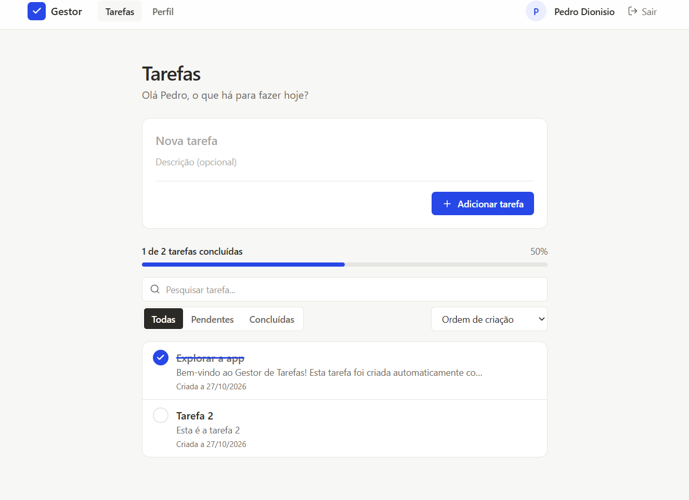
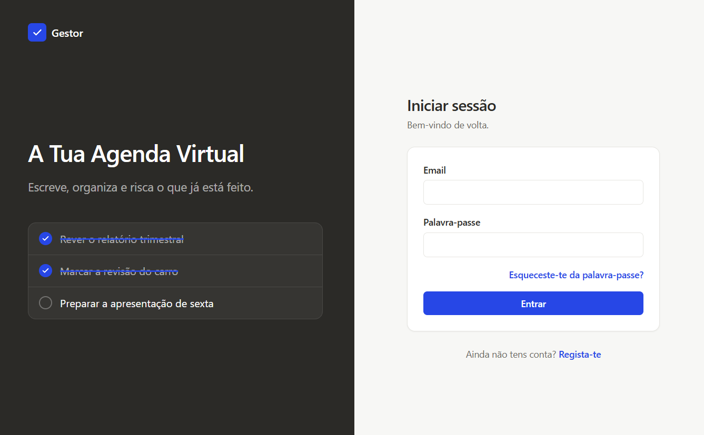
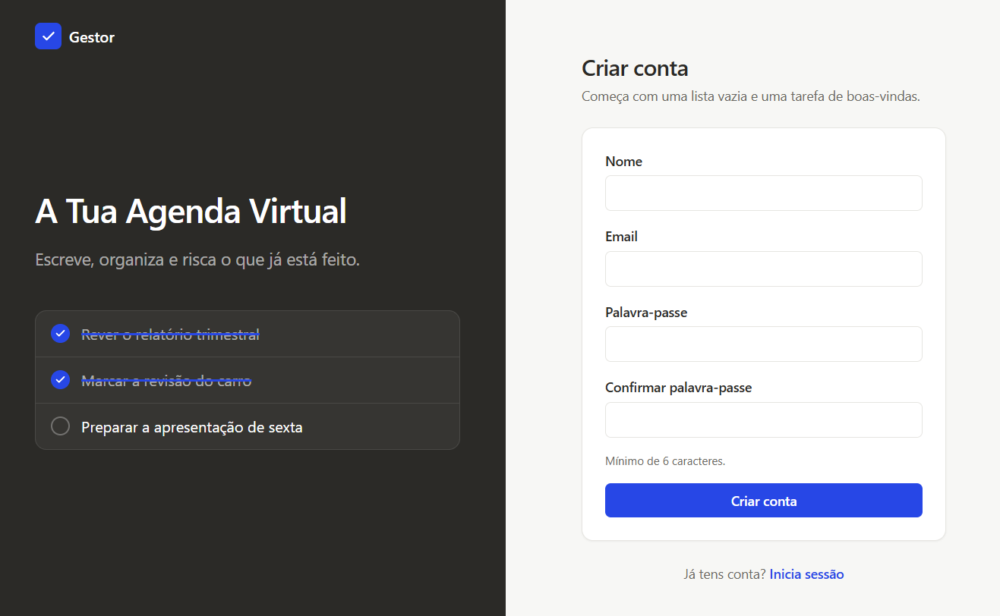

# 📋 Gestor de Tarefas

Aplicação web para gestão de tarefas do dia a dia, construída como projeto de aprendizagem em React. Cobre desde os fundamentos (componentes, estado, props) até navegação entre páginas, autenticação real e uma base de dados relacional (PostgreSQL) através do Supabase.

## 🚀 Tecnologias

| Tecnologia                                 | Utilização                                                                         |
| ------------------------------------------ | ---------------------------------------------------------------------------------- |
| **React 18** + **Vite**                    | Base da aplicação e ambiente de desenvolvimento                                    |
| **React Router 6** (`createBrowserRouter`) | Navegação SPA, rotas dinâmicas e rotas protegidas                                  |
| **Context API** + `useReducer`             | Estado global da sessão e do perfil (`AuthContext`) e das tarefas (`TasksContext`) |
| **Supabase Auth**                          | Registo, login, sessões e confirmação de email                                     |
| **Supabase (PostgreSQL)**                  | Base de dados relacional, com Row Level Security                                   |
| **Tailwind CSS**                           | Estilos, com tema próprio (cores e tipografia)                                     |
| **Lucide React**                           | Ícones                                                                             |
| **ESLint**                                 | Qualidade e consistência do código                                                 |

## ✨ Funcionalidades

### Autenticação

- 📝 Registo com nome, email e palavra-passe, com confirmação de email
- 🔐 Login e logout, com mensagens de erro claras (credenciais erradas, email por confirmar, conta já existente)
- 🔑 Recuperação de palavra-passe por email, com link de uso único
- 🛡️ Rotas protegidas: sem sessão iniciada, o utilizador é redirecionado para o login e, depois de entrar, volta à página que tentou abrir
- 💾 A sessão mantém-se ao atualizar a página e termina com "Sair"

### Perfil

- 👤 Página de perfil com nome, email e "Sobre mim"
- ✏️ Edição do nome e do "Sobre mim", com atualização imediata no cabeçalho

### Tarefas

- 👋 Cada conta nova começa com a tarefa "Explorar a app", criada automaticamente pela base de dados
- ➕ Criar tarefas com título e descrição, com validação de campos vazios
- ✔️ Marcar e desmarcar tarefas como concluídas
- ✏️ Editar o título e a descrição, na lista ou na página de detalhe
- 🗑️ Apagar tarefas, com pedido de confirmação
- 🔍 Página de detalhe para cada tarefa (`/tarefas/:id`), com "Mostrar mais" nas descrições longas
- 👥 **Tarefas separadas por utilizador:** cada conta vê apenas as suas tarefas, garantido na própria base de dados

### Organização

- 🗂️ Filtros: Todas, Pendentes e Concluídas
- 🔎 Pesquisa por título em tempo real
- ↕️ Ordenação por data de criação ou por título
- 📊 Contador de tarefas concluídas
- 📅 Datas guardadas pela base de dados e apresentadas em formato português

## 🎨 Design

- **Estilo minimalista**: Inspirado no Notion: fundos neutros, texto quase preto e uma única cor de destaque (azul) reservada para as ações principais e para as tarefas concluídas
- **Tipografia**: Instrument Sans e tema próprio definido no `tailwind.config.js`, para alterar cores e letra num só sítio
- **Responsivo**: Menu próprio no telemóvel; login e registo em duas colunas nos ecrãs grandes
- **Componentes reutilizáveis**: (`Button`, `FormField`, `Avatar`, `Logo`) para manter o mesmo aspeto em toda a app
- **Acessibilidade**: Contraste de cores, navegação completa por teclado e alvos de toque de pelo menos 24px

> **Nota:** Toda a direção visual (estilo minimalista a preto e branco com uma cor de destaque, e a organização das páginas de login, registo, Recuperar Password) foi definida por mim. A implementação do sistema de estilos (tema do Tailwind, componentes e regras de acessibilidade) foi feita com apoio de IA, como forma de acelerar o processo e depois revista e ajustada por mim.

## 🗄️ Base de dados

```
auth.users (Supabase)  1 ── 1  profiles  1 ── N  tasks
```

- **`profiles`**: Nome e "Sobre mim" de cada conta (o `id` é o mesmo da conta)
- **`tasks`**: As tarefas, cada uma ligada ao seu user
- **Row Level Security**: Cada utilizador só consegue ler e alterar o seu perfil e as suas tarefas
- **Trigger**: Ao criar uma conta, cria automaticamente o perfil e a tarefa de boas-vindas

O esquema completo está em [`supabase/schema.sql`](supabase/schema.sql).

> **Nota:** o modelo de dados (tabelas, relações e regras) foi pensado por mim. O ficheiro `schema.sql` (criação das tabelas, políticas de Row Level Security e trigger) foi escrito com apoio de IA, para acelerar o processo, e depois analisado e testado por mim.

## 🛠️ Como correr o projeto localmente

1. Clonar e instalar:
   ```bash
   git clone https://github.com/PedroDionisio/Gestor-de-Tarefas-React.git
   cd Gestor-de-Tarefas-React
   npm install
   ```
2. Criar um projeto no [Supabase](https://supabase.com) e correr o `supabase/schema.sql` no **SQL Editor**.
3. Criar o ficheiro `.env` e preencher com o **Project URL** e a **Publishable key** do teu projeto:
   ```
   VITE_SUPABASE_URL=https://o-teu-projeto.supabase.co
   VITE_SUPABASE_KEY=a-tua-chave-publica
   ```
4. Iniciar:
   ```bash
   npm run dev
   ```

## 📸 Pré-visualização

<div align="center">
  
  <br/>
  <em>Lista de tarefas com progresso, filtros e pesquisa</em>
  <br/><br/>
  <table>
    <tr>
      <td align="center">
        
        <br/>
        <em>Login</em>
      </td>
      <td align="center">
        
        <br/>
        <em>Registo</em>
      </td>
    </tr>
  </table>
</div>

Projeto desenvolvido para fins de aprendizagem.
